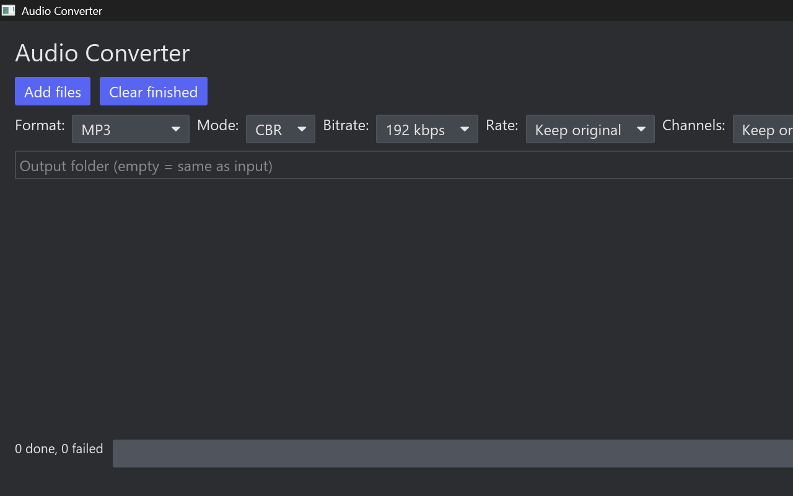

# 🎵 Tempo

[](LICENSE)
[](https://www.rust-lang.org/)
[]()

> **Tempo** is a fast, modern, privacy-first audio converter built with Rust. 100% free and open-source — no cloud uploads, no ads, no paywalls.



---

## ✨ Features

- **🔒 100% Offline & Private**: All conversions run locally on your CPU. No accounts, no internet connection required, and zero telemetry.
- **⚡ Blazingly Fast**: Native performance powered by Rust, multi-threaded worker pools, and Link-Time Optimization (LTO).
- **🖥️ Clean Desktop GUI (`tempo`)**: Built with [Iced](https://github.com/iced-rs/iced) — drag & drop audio files, track real-time progress, and batch convert full albums with one click.
- **💻 Scriptable CLI (`tempo-cli`)**: Includes a dedicated command-line interface for automation, power users, and shell scripts.
- **🏷️ Metadata & Tag Preservation**: Transfers title, artist, album, genre, year, track numbers — and embedded cover art (MP3, FLAC, M4A, Opus, OGG) — between formats seamlessly.
- **🎛️ Audio Customization**: Fine-tune CBR/VBR bitrates, sample rates (powered by the high-quality [Rubato](https://github.com/HEnquist/rubato) resampler), and channel configurations (Mono/Stereo).

---

## 🎧 Supported Formats

| Format | Decoding (Input) | Encoding (Output) | Encoder Engine |
| :--- | :---: | :---: | :--- |
| **MP3** (`.mp3`) | ✅ | ✅ | LAME (`mp3lame-encoder`) |
| **FLAC** (`.flac`) | ✅ | ✅ | `flacenc` (Lossless) |
| **WAV** (`.wav`, `.wave`) | ✅ | ✅ | `hound` (Lossless PCM) |
| **M4A / AAC** (`.m4a`, `.mp4`, `.aac`) | ✅ | ✅ | Fraunhofer FDK-AAC (`fdk-aac`) |
| **Opus** (`.opus`) | ✅ | ✅ | libopus (`audiopus`) |
| **Ogg Vorbis** (`.ogg`, `.oga`) | ✅ | ✅ | `vorbis_rs` |
| **AIFF** (`.aiff`, `.aif`) | ✅ | ✅ | Custom writer (Lossless PCM) |

---

## 🚀 Getting Started

### 1. Graphical Desktop App (`tempo`)

Launch the application:
- On Windows, double-click **`tempo.exe`** (or run `Start-Process tempo.exe` in PowerShell).

**Usage:**
1. Click **Add files** or drag & drop audio tracks directly into the window.
2. Select your target **Format** (e.g. MP3, FLAC, M4A) and adjust bitrate/quality options.
3. (Optional) Choose a destination folder (defaults to the source directory).
4. Click **Start** to convert.

---

### 2. Command-Line Interface (`tempo-cli`)

Use `tempo-cli` for quick conversions or batch scripts:

```powershell
# Basic conversion: WAV to MP3
tempo-cli -f mp3 "song.wav" "song.mp3"

# High-quality FLAC to AAC (M4A) with custom bitrate
tempo-cli -f m4a -b 256 "track.flac" "track.m4a"

# Convert to Opus with custom sample rate and mono channels
tempo-cli -f opus -b 96 --sample-rate 48000 --channels 1 "input.wav" "output.opus"

# View all options and supported flags
tempo-cli --help
```

---

## 🛠️ Building From Source

### Prerequisites

- [Rust & Cargo](https://rustup.rs/) (Stable 1.80+)
- **Windows**: MinGW 64-bit GCC toolchain (required for C-based audio codecs: LAME, FDK-AAC, Opus).
- **Linux**: Standard build essentials (`gcc`, `g++`, `libopus-dev`, `pkg-config`).
- **macOS**: Xcode Command Line Tools.

### Build Commands

```bash
# Clone the repository
git clone https://github.com/hemil2005/tempo.git
cd tempo

# Build development binaries (Windows: requires MinGW-w64; see Prerequisites)
cargo build

# Build optimized release binaries (LTO enabled)
powershell -ExecutionPolicy Bypass -File .\build.ps1 build --release

# Run automated tests
powershell -ExecutionPolicy Bypass -File .\build.ps1 test
```

Binaries will be placed in `target/release/`:
- **`tempo.exe`** — Graphical Desktop Application
- **`tempo-cli.exe`** — Command-Line Tool

---

## 📂 Architecture

This repository is structured as a Cargo workspace:

```text
tempo/
├── converter-core/     # Audio processing engine (decoding, resampling, encoding, metadata tags)
├── converter-cli/      # Command-line interface (tempo-cli)
├── converter-app/      # Desktop GUI interface (tempo)
├── assets/             # Screenshots and branding icons
└── testdata/           # Test audio suites and verification clips
```

---

## 🗺️ Roadmap

- [x] Multi-format decode and encode core engine
- [x] Multi-threaded batch conversion worker pool
- [x] Desktop GUI with drag-and-drop support
- [x] CLI interface (`tempo-cli`)
- [x] Embedded album art / cover art preservation (MP3, FLAC, M4A, Opus, OGG)
- [x] Folder-level recursive batch conversion
- [x] Beginner-friendly preset profiles ("High Quality", "Balanced", "Space Saver")
- [x] Automated GitHub Actions release binaries for Windows, macOS, and Linux
- [ ] Distribution via `winget` and package managers

---

## 📄 License & Attribution

This project is licensed under the [MIT License](LICENSE).  
For third-party codec licenses and attribution (Symphonia, LAME, Opus, FDK-AAC, Iced), see [THIRDPARTY.md](THIRDPARTY.md).
